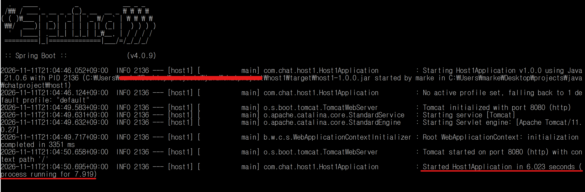
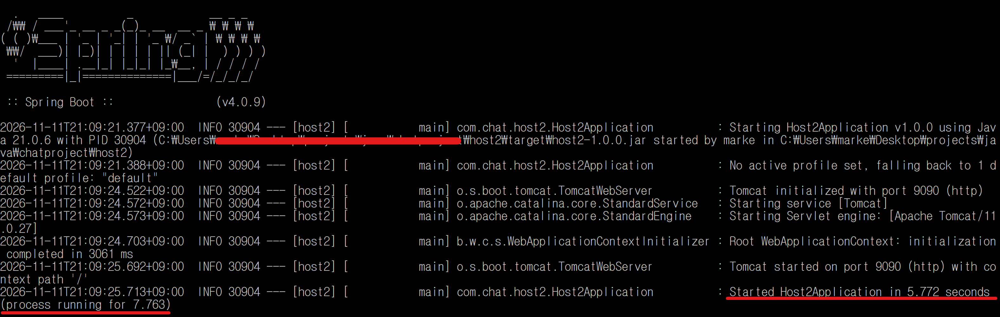
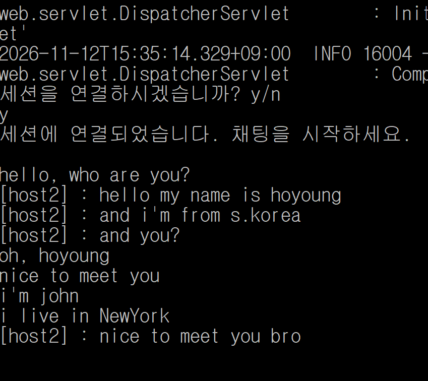
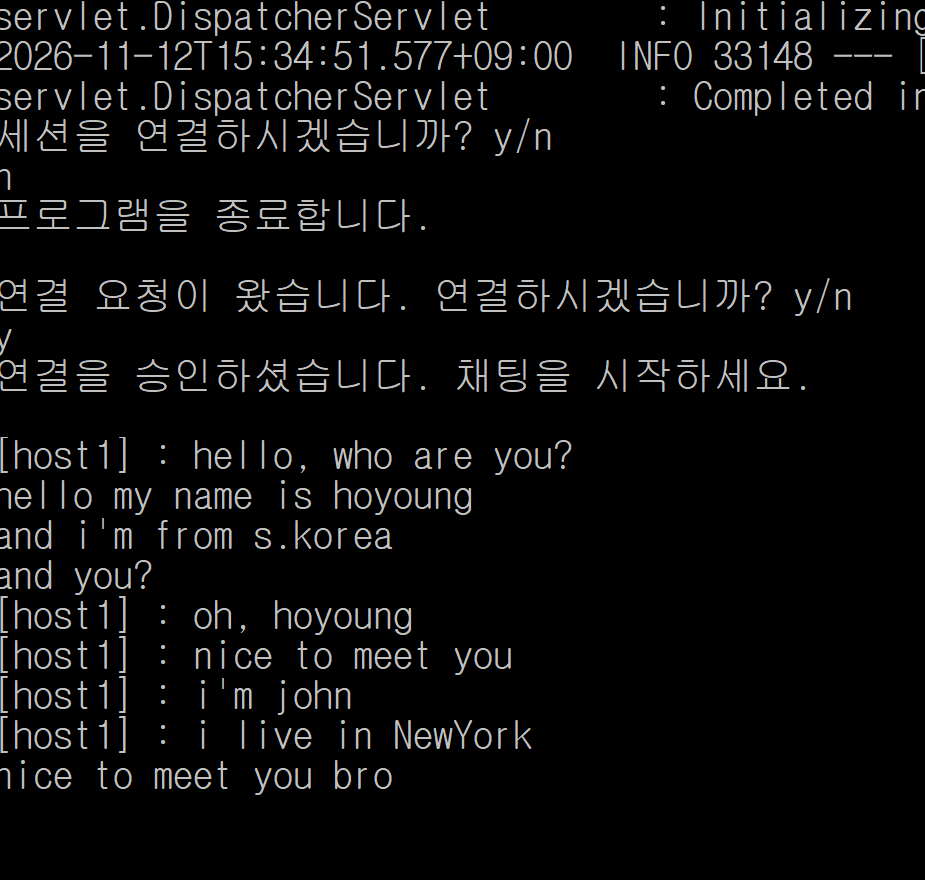
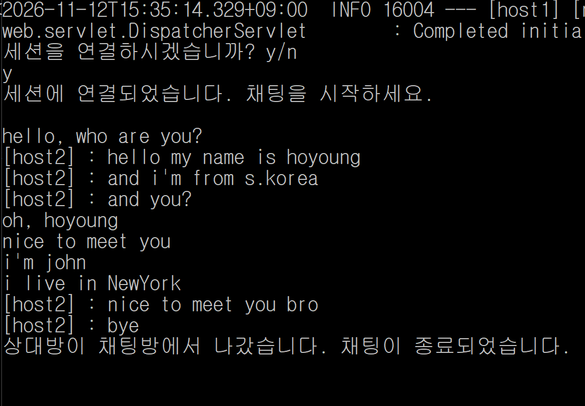

# 1. 프로젝트 간단 소개
RestTemplate를 활용해 구현한 간단한 채팅 애플리케이션 데모 버전입니다 😅<br><br>
이 프로젝트의 구조는<br>
한 개의 상위 프로젝트(chat-application-using-restTemplate-demo) 안에<br>
두 개의 하위 프로젝트(host1, host2) 로 구성 되어있습니다.
<br>
<br>

# 2. 애플리케이션 사용 방법
아래에 작성된 사용법을 순서대로 체크하면서 따라가주세요<br>
<br>

## a. 실행 환경 준비
실행 환경을 다음과 같이 준비해주세요.
- [ ] JDK : JDK 21 이상 설치
- [ ] OS : MS Windows 10/11 64bits
- [ ] 이 레포지토리를 다운로드 받아, 원하는 디렉토리에서 압축을 풀어주세요<br>
      만약 로컬 기기에 git이 설치되어 있다면 터미널을 실행한 뒤, 다음 명령어들을 순서대로 입력해주세요.<br><br>
  ```cmd
  cd {상위 프로젝트를 다운로드 받기 원하는 폴더 주소}
  ```
  ```cmd
  git clone https://github.com/bboljjim/chat-application-using-restTemplate-demo.git
  ```
<br>

## b. 애플리케이션 실행
아래 순서에 따라 진행해 host1과 host2를 각각 실행시켜 주세요.<br><br>
※ 참고<br>
host2는 host1과 기능과 로직이 완전하게 똑같은 애플리케이션입니다.<br>
데모 버전이라서 같은 기기에서 기능 테스트를 하기 위해서 host2를 추가해 놓았을 뿐입니다.<br>
실제 배포 시에는 서로 다른 각 기기에서 host1만 설치하고 실행하는 것으로 충분합니다.<br><br>

### i ) 터미널 실행
- [ ] 터미널(명령 프롬프트 or PowerShell)창을 두 개 켭니다.<br>
      (앞으로 이를 A 터미널, B 터미널로 지칭하겠습니다.)
### ii ) host1 실행
- [ ] A 터미널 창을 열고 다음 명령어를 입력하여 하위 프로젝트인 host1의 루트 디렉토리로 이동합니다.
  <br><br>
  ```cmd
  cd {상위 프로젝트를 다운 받은 폴더 주소}\host1
  ```
  <br>
- [ ] 다음 명령어를 입력하여 host1을 실행시킵니다.
  <br><br>
  ```cmd
  java -jar target\host1-1.0.0.jar
  ```
  <br>
  터미널 창에 아래 사진 같이 떠야 정상입니다.
  <br><br>
  
  <br>

### iii ) host2 실행
- [ ] B 터미널 창을 열고 다음 명령어를 입력하여 하위 프로젝트인 host2의 루트 디렉토리로 이동합니다.<br><br>
  ```cmd
  cd {상위 프로젝트를 다운 받은 폴더 주소}\host2
  ```
  <br>
- [ ] 다음 명령어를 입력하여 host2를 실행시킵니다.<br><br>
  ```cmd
  java -jar target\host2-1.0.0.jar
  ```
  <br>
  위 사진 같이 뜬다면 정상적으로 실행된 것입니다.<br><br>
  


## c. URL 주소 입력
host1, host2가 모두 실행중인 상태에서 아무 웹 브라우저를 켜고 주소란에 다음 URL 주소를 입력해주세요
```
http://localhost:8080/host1/request-connection<br>
```
혹은
```
http://localhost:9090/host2/request-connection
```
입력 후 브라우저에 아무 화면도 안뜨는게 정상입니다<br><br>

## d. 터미널 창을 확인하면서 진행
### i ) 터미널 출력 메세지 확인
- [ ] 위쪽 URL 링크에 접속하셨다면 A 터미널 창을 확인 해주세요<br>
아래쪽 URL 링크에 접속하셨다면 B 터미널 창을 확인 해주세요<br><br>
- [ ] 아래 메세지가 출력되었다면 터미널에 `y` 또는 `yes`를 입력하세요.<br><br>
  ```
  채팅을 연결하시겠습니까 y/n
  ```
### ii ) 이제 다른 쪽 터미널 창을 확인해보세요
- [ ] 전 단계에서 확인하지 않았던 다른 터미널 창을 확인해주세요<br><br>
- [ ] 아래 메세지가 출력되었다면 터미널에 `y` 또는 `yes`를 입력하세요.<br><br>
  ```
  연결 요청이 왔습니다. 연결하시겠습니까? y/n
  ```

### iii ) 두 터미널 창 모두 확인
- [ ] 이제 두 개의 터미널 창을 모두 확인해주세요

- [ ] 두 터미널 창에 아래 메세지가 출력되었다면<br>
이제 터미널에 메세지를 입력하여 채팅을 진행하실 수 있습니다
  ```
  채팅방에 연결되었습니다. 채팅을 시작하세요
  ```
  <br>
  [ 채팅 진행 참고 이미지 ]<br><br>

  
  

### iv ) 채팅 종료
터미널에 `bye`를 입력하시면 채팅이 종료됩니다.<br><br>
